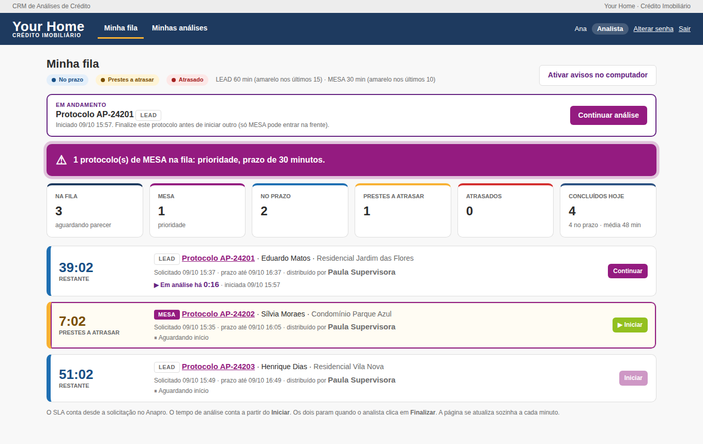
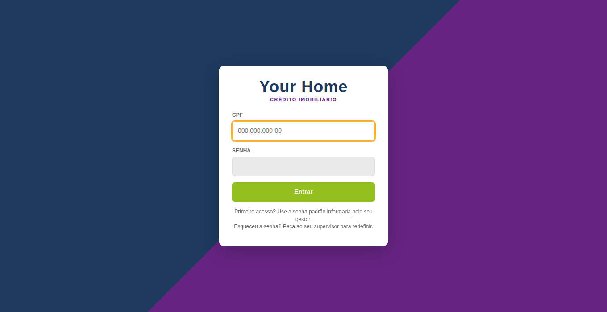
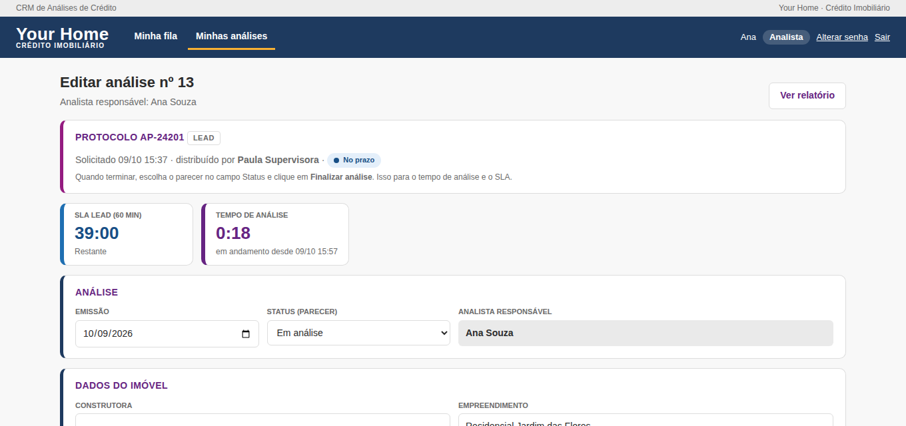
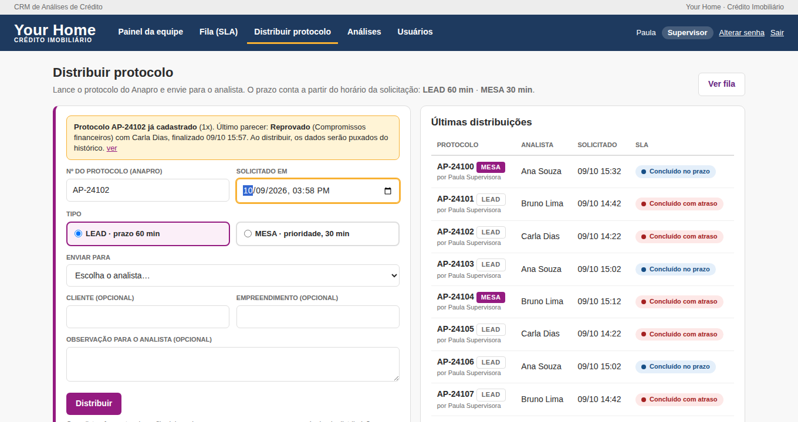
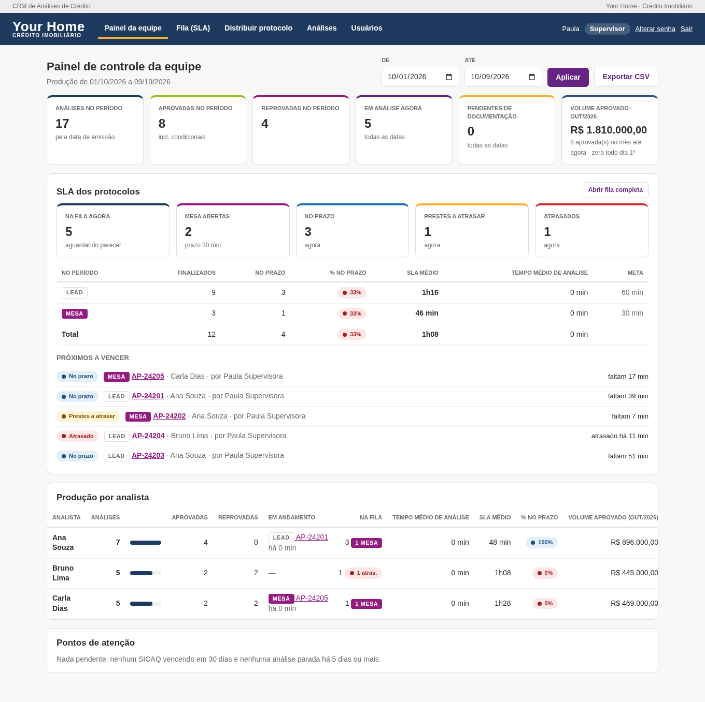
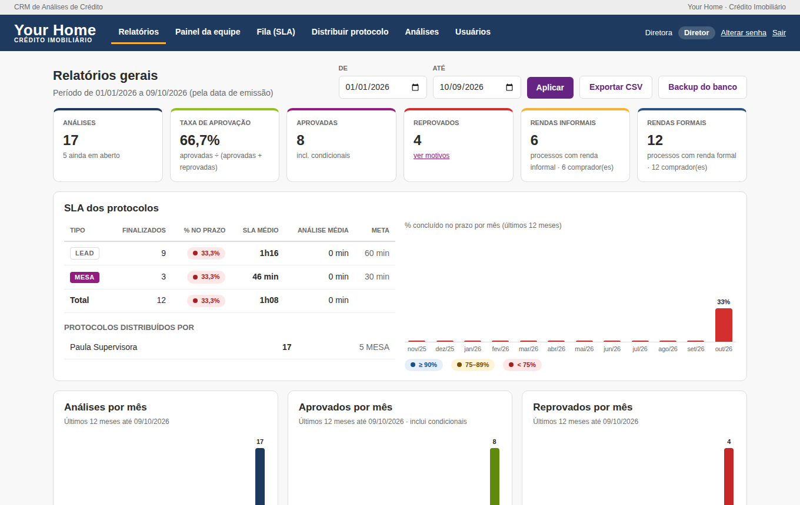
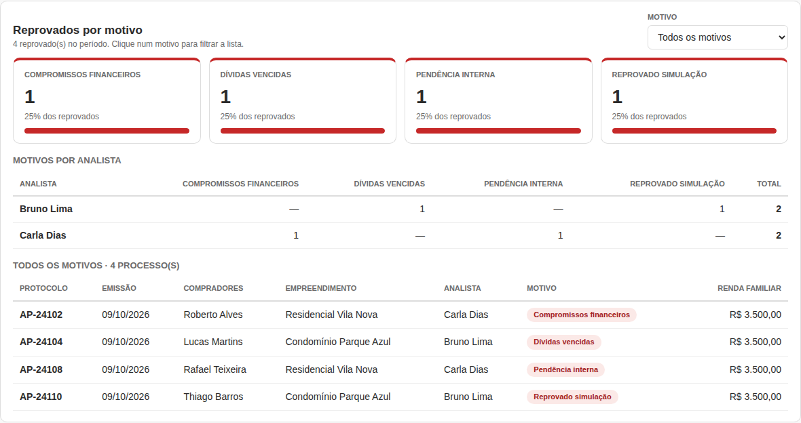
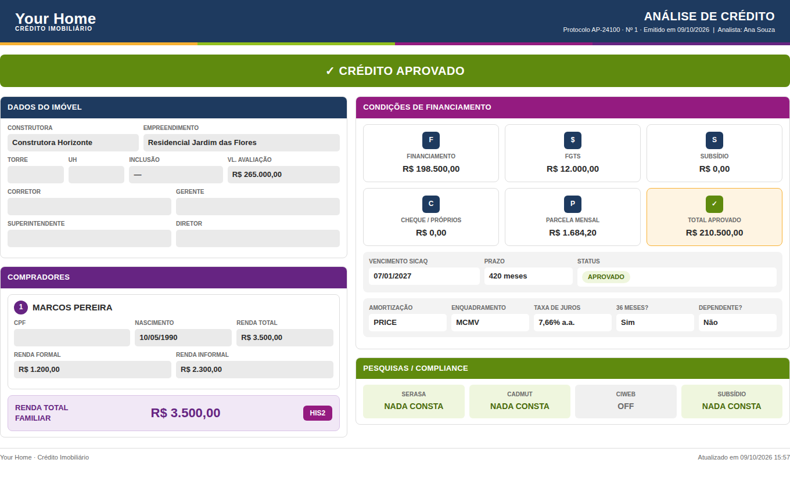

<h1 align="center">🏠 Your Home · CRM de Análises de Crédito Imobiliário</h1>

<p align="center">
  Sistema web para <b>distribuir, acompanhar e medir</b> as análises de crédito imobiliário de uma equipe,<br>
  com controle de <b>SLA em tempo real</b>, perfis de acesso, painel do gestor e relatórios da diretoria.
</p>

<p align="center">
  
  
  
  
  
</p>

<p align="center">
  
</p>

---

## Sumário

- [Sobre o projeto](#sobre-o-projeto)
- [Funcionalidades](#funcionalidades)
- [Regras de negócio](#regras-de-negócio)
- [Telas](#telas)
- [Tecnologias](#tecnologias)
- [Como executar](#como-executar)
- [Modo demonstração](#modo-demonstração)
- [Testes](#testes)
- [Arquitetura](#arquitetura)
- [Segurança](#segurança)
- [Configuração](#configuração)
- [Backup e atualização](#backup-e-atualização)
- [Próximos passos](#próximos-passos)
- [Autora](#autora)

---

## Sobre o projeto

Em correspondentes de crédito imobiliário, cada protocolo que chega do sistema de origem (o **Anapro**) tem prazo
para receber o parecer: **1 hora para LEAD** e **30 minutos para MESA**, que é prioridade. Sem uma ferramenta própria,
esse controle costuma ficar espalhado em planilhas, sem visão do que está atrasando e sem histórico de quem fez o quê.

Este CRM centraliza o processo de ponta a ponta:

1. o **supervisor** lança o protocolo do Anapro com o horário da solicitação e distribui para um analista;
2. o **analista** vê o protocolo na fila com contagem regressiva, clica em **Iniciar**, preenche a análise e clica em **Finalizar**;
3. o sistema registra o **SLA** (da solicitação até o parecer) e o **tempo de análise** (do Iniciar ao Finalizar);
4. **gerentes** acompanham a equipe em tempo real, e a **diretoria** vê os indicadores consolidados, inclusive os motivos de reprova.

O relatório de cada análise sai no layout padrão da empresa, pronto para imprimir ou salvar em PDF.

---

## Funcionalidades

### Acesso e perfis

- Login com **CPF e senha**. Todo usuário novo recebe a senha padrão `abc123`, e o sistema **obriga a troca** no primeiro acesso.
- Quatro perfis com permissões diferentes:

| Ação | Analista | Supervisor | Gerente | Diretor |
|---|:-:|:-:|:-:|:-:|
| Ver e editar as **próprias** análises | ✓ | ✓ | ✓ | ✓ |
| Ver e editar análises de **todos** | – | ✓ | ✓ | ✓ |
| Distribuir protocolos, marcar MESA, transferir, reabrir | – | ✓ | ✓ | ✓ |
| Painel da equipe e exportação CSV | – | ✓ | ✓ | ✓ |
| Relatórios gerais e backup do banco | – | – | – | ✓ |
| Cadastrar, desativar e excluir usuários | – | analistas | analistas e supervisores | todos |
| Editar dados cadastrais | – | analistas | + diretor | todos |

### Fila e SLA

- Fila do analista com **contagem regressiva ao vivo** e cores de situação:
  🔵 **azul**: no prazo · 🟡 **amarelo**: prestes a atrasar · 🔴 **vermelho**: atrasado.
- Protocolos **MESA** sempre no topo, com alerta em destaque.
- Aviso sonoro e notificação do Windows quando chega protocolo novo.
- Dois cronômetros: **SLA** (desde a solicitação no Anapro) e **tempo de análise** (desde o Iniciar).

### Distribuição

- O supervisor informa o nº do protocolo, a data e hora da solicitação, o tipo (LEAD ou MESA) e o analista.
- Ao digitar o número, o sistema **consulta na hora** se o protocolo já existe:
  - se já foi finalizado antes, permite **redistribuir puxando os dados do histórico**, sem recadastrar;
  - se ainda está em andamento, bloqueia e indica a transferência.
- Transferência entre analistas e marcação de MESA a qualquer momento.

### Análise de crédito

- Dados do imóvel, compradores (quantos forem necessários), renda formal e informal, condições de financiamento
  e pesquisas de compliance (Serasa, CADMUT, CIWEB, Subsídio).
- Renda familiar e total aprovado calculados automaticamente.
- Ao reprovar, o **motivo é obrigatório**: Compromissos financeiros, Dívidas vencidas, Pendência interna ou Reprovado simulação.
- **Histórico** completo de cada análise: distribuição, início, transferências, mudança para MESA, parecer e tempos.

### Painel da equipe (gestão)

- Fila agora: quantos protocolos estão no prazo, prestes a atrasar e atrasados, e quantas MESAs há em aberto.
- Por analista: o que está **em andamento** neste momento, tamanho da fila, tempo médio de análise, SLA médio e % no prazo.
- **Volume aprovado do mês corrente**, que zera automaticamente todo dia 1º.
- Pontos de atenção: SICAQ vencido ou vencendo em 30 dias e análises paradas há 5 dias ou mais.

### Relatórios da diretoria

- Indicadores: análises, taxa de aprovação, aprovadas, reprovadas, processos com renda informal e com renda formal.
- SLA por tipo (LEAD e MESA) e % no prazo mês a mês.
- Gráficos de **análises, aprovados e reprovados por mês**.
- Painel de **reprovados por motivo**, com filtro, tabela de motivos por analista e lista dos processos.
- Desempenho por analista, top construtoras e produtividade de cada supervisor na distribuição.
- Exportação para **CSV** (abre no Excel) e download de **backup** do banco.

---

## Regras de negócio

| Tipo | Prazo (SLA) | Fica amarelo quando faltam |
|---|---|---|
| LEAD | 60 min | 15 min ou menos |
| MESA (prioridade) | 30 min | 10 min ou menos |

- O SLA conta a partir do **horário de solicitação no Anapro**, e não do horário da distribuição.
- O **tempo de análise** conta a partir do clique em **Iniciar**.
- Os dois param quando o analista clica em **Finalizar** com um parecer escolhido. Clicar só em **Salvar** não para o relógio.
- **Um processo por vez:** com um protocolo iniciado e não finalizado, o analista não consegue iniciar outro.
  **Exceção:** MESA pode ser iniciada a qualquer momento.
- Se um protocolo em andamento é transferido, o novo analista precisa clicar em Iniciar de novo.
- A contagem é em minutos corridos, pelo relógio do servidor.
- Os prazos ficam em constantes no início do `app.py` (`SLA_MIN` e `SLA_AVISO_MIN`).

---

## Telas

> Todas as telas abaixo usam dados fictícios gerados pelo [modo demonstração](#modo-demonstração).

| | |
|---|---|
| **Login com CPF**<br> | **Fila do analista**<br> |
| **Análise com cronômetros e motivo de reprova**<br> | **Distribuição com consulta de protocolo**<br> |
| **Painel da equipe**<br> | **Relatórios da diretoria**<br> |
| **Reprovados por motivo**<br> | **Relatório da análise (impressão/PDF)**<br> |

---

## Tecnologias

| Camada | Tecnologia |
|---|---|
| Back-end | Python 3.9+ e Flask 3 |
| Servidor | Waitress (WSGI, roda em Windows sem configuração extra) |
| Banco de dados | SQLite (arquivo único, sem instalação) |
| Front-end | Templates Jinja2, HTML, CSS e JavaScript puro (sem frameworks) |
| Gráficos | Barras em HTML/CSS, sem bibliotecas externas |
| Senhas | Hash com `werkzeug.security` (scrypt) |
| Testes | Cliente de testes do Flask, com 88 verificações de ponta a ponta |

Sem dependências de front-end nem build: o sistema roda num PC comum da empresa e é acessado pelo navegador por toda a rede interna.

---

## Como executar

### Windows (jeito mais fácil)

1. Instale o **Python 3.9+** em [python.org](https://www.python.org/downloads/) e marque **"Add python.exe to PATH"**.
2. Baixe o projeto, extraia a pasta e dê dois cliques em **`iniciar.bat`**.
3. O script verifica o Python, cria o ambiente, instala as dependências e abre o navegador em `http://localhost:5000`.
4. A janela mostra também o endereço para os outros computadores da rede (ex.: `http://192.168.0.10:5000`).

### Linux, macOS ou terminal

```bash
git clone https://github.com/ThaisRAquino/yourhome-crm.git
cd yourhome-crm
python -m venv .venv
source .venv/bin/activate        # Windows: .venv\Scripts\activate
pip install -r requirements.txt
python app.py
```

### Primeiro acesso

1. Na primeira execução, o sistema pede o cadastro do **Diretor** (nome e CPF).
2. Entre com o CPF e a senha **`abc123`** e crie sua senha pessoal.
3. Em **Usuários**, cadastre gerentes, supervisores e analistas.

---

## Modo demonstração

Para conhecer o sistema sem cadastrar nada:

```bash
python demo.py
```

O script cria um banco **separado** (`demo_crm.db`) com usuários, protocolos finalizados e uma fila em andamento,
e abre o sistema em `http://localhost:5000`. O banco real (`mba_crm.db`) não é tocado.

| Perfil | CPF | Senha |
|---|---|---|
| Diretor | 111.444.777-35 | `Diretor2026` |
| Gerente | 529.982.247-25 | `Gerente2026` |
| Supervisor | 168.995.350-09 | `Superv2026` |
| Analista | 390.533.447-05 | `Analista2026` |

> Os CPFs são fictícios, válidos apenas no formato.

---

## Testes

```bash
python tests/test_fluxos.py
```

São **88 verificações de ponta a ponta**, rodando num banco temporário. Elas cobrem:

- **Login:** troca obrigatória de senha, bloqueio após 5 tentativas e proteção CSRF;
- **Permissões:** o que cada perfil pode ver e fazer;
- **SLA:** cores, ordenação da fila (MESA primeiro), iniciar, finalizar, trava de um processo por vez e exceção para MESA;
- **Distribuição:** redistribuição puxando o histórico, bloqueio de protocolo em andamento e de horário no futuro;
- **Reprova:** motivo obrigatório e filtros dos relatórios;
- **Usuários:** exclusão com transferência das análises e permissões do gerente sobre o diretor;
- **Banco:** migração automática de bancos antigos.

---

## Arquitetura

```
yourhome-crm/
├── app.py               # aplicação Flask: rotas, regras de negócio, SLA e migração do banco
├── demo.py              # gera dados fictícios e sobe o sistema em modo demonstração
├── iniciar.bat          # inicializador para Windows (verifica Python, instala e abre o navegador)
├── requirements.txt     # Flask e Waitress
├── static/
│   └── style.css        # identidade visual e telas (claro, responsivo e com estilo de impressão)
├── templates/           # telas em Jinja2
│   ├── base.html, login_base.html
│   ├── login.html, setup.html, trocar_senha.html
│   ├── fila.html, distribuir.html
│   ├── analises.html, analise_form.html, relatorio.html
│   ├── painel.html, relatorios.html
│   └── usuarios.html, usuario_form.html, usuario_excluir.html, erro.html
├── tests/
│   └── test_fluxos.py   # testes de ponta a ponta
└── docs/prints/         # imagens usadas neste README
```

### Modelo de dados (SQLite)

| Tabela | Conteúdo |
|---|---|
| `usuarios` | CPF (login), nome, e-mail, perfil, hash da senha, troca obrigatória, tentativas, bloqueio, último acesso |
| `analises` | protocolo, tipo (LEAD/MESA), solicitado/distribuído/iniciado/finalizado em, analista, quem distribuiu, status, motivo da reprova, origem (redistribuição), campos-resumo para relatórios e os dados completos da análise em JSON |
| `historico` | linha do tempo de cada análise: quem fez o quê e quando |

As colunas novas são criadas automaticamente na inicialização (**migração automática**). Por isso, atualizar a versão não exige mexer no banco.

### Principais rotas

| Rota | Descrição |
|---|---|
| `/login`, `/trocar-senha`, `/setup` | autenticação e configuração inicial |
| `/fila` | fila com SLA em tempo real |
| `/distribuir`, `/distribuir/consulta` | distribuição e consulta de protocolo (JSON) |
| `/analises`, `/analises/<id>`, `/analises/<id>/editar` | lista, relatório e formulário |
| `/analises/<id>/iniciar`, `/reabrir`, `/mesa`, `/transferir` | ações do fluxo |
| `/painel` | painel da equipe |
| `/relatorios`, `/relatorios/exportar.csv`, `/backup` | relatórios da diretoria, CSV e backup |
| `/usuarios/...` | cadastro, edição, redefinição de senha, desativação e exclusão |

---

## Segurança

- **Senhas:** guardadas com hash (scrypt), nunca em texto puro. A senha pessoal exige 8 caracteres ou mais, com letras e números, e não pode ser igual à padrão nem ao CPF.
- **Tentativas de login:** depois de 5 senhas erradas, o acesso fica bloqueado por 15 minutos.
- **Sessão:** expira em 9 horas, com cookies `HttpOnly` e `SameSite=Lax`.
- **CSRF:** há um token em todos os formulários.
- **Permissões:** checadas no servidor em toda rota, e não só escondidas na tela.
- **Exclusão de usuário:** exige confirmar o CPF e escolher para quem vão as análises da pessoa; o histórico é preservado.

> ⚠️ O sistema guarda **CPF e renda de clientes**. Para uso fora da rede interna, publique com **HTTPS** e alinhe com o responsável de TI e LGPD.

---

## Configuração

| Variável de ambiente | Padrão | Para quê |
|---|---|---|
| `PORT` | `5000` | porta do servidor |
| `MBA_DB` | `mba_crm.db` | caminho do arquivo do banco |
| `MBA_SECRET_KEY` | gerada em `.secret_key` | chave das sessões (defina em produção) |

Os prazos de SLA, os motivos de reprova e a senha padrão ficam em constantes no início do `app.py`.
Para usar o logo da empresa, salve o arquivo como `static/logo.png`.

---

## Backup e atualização

- **Backup:** todos os dados ficam no arquivo `mba_crm.db`. O diretor baixa uma cópia em *Relatórios → Backup do banco*.
- **Atualização:** substitua os arquivos do sistema e mantenha o `mba_crm.db` e o `.secret_key`. A migração roda sozinha.
- **Arquivos fora do Git:** o banco, a chave e o ambiente virtual estão no `.gitignore` e nunca vão para o repositório.

---

## Próximos passos

- [ ] Integração direta com o Anapro para importar protocolos sem digitação
- [ ] SLA contado em horário comercial (desconsiderando noites e fins de semana)
- [ ] Painéis de aprovados por analista e por construtora
- [ ] Recuperação de senha por e-mail
- [ ] Deploy em nuvem com PostgreSQL

Veja o histórico de versões no [CHANGELOG](CHANGELOG.md).

---

## Autora

**Thais Ribeiro de Aquino**: analista de crédito imobiliário em transição para desenvolvimento de sistemas,
estudante de Análise e Desenvolvimento de Sistemas.

[](https://www.linkedin.com/in/thais-ribeiro-de-aquino)
[](https://github.com/ThaisRAquino)
